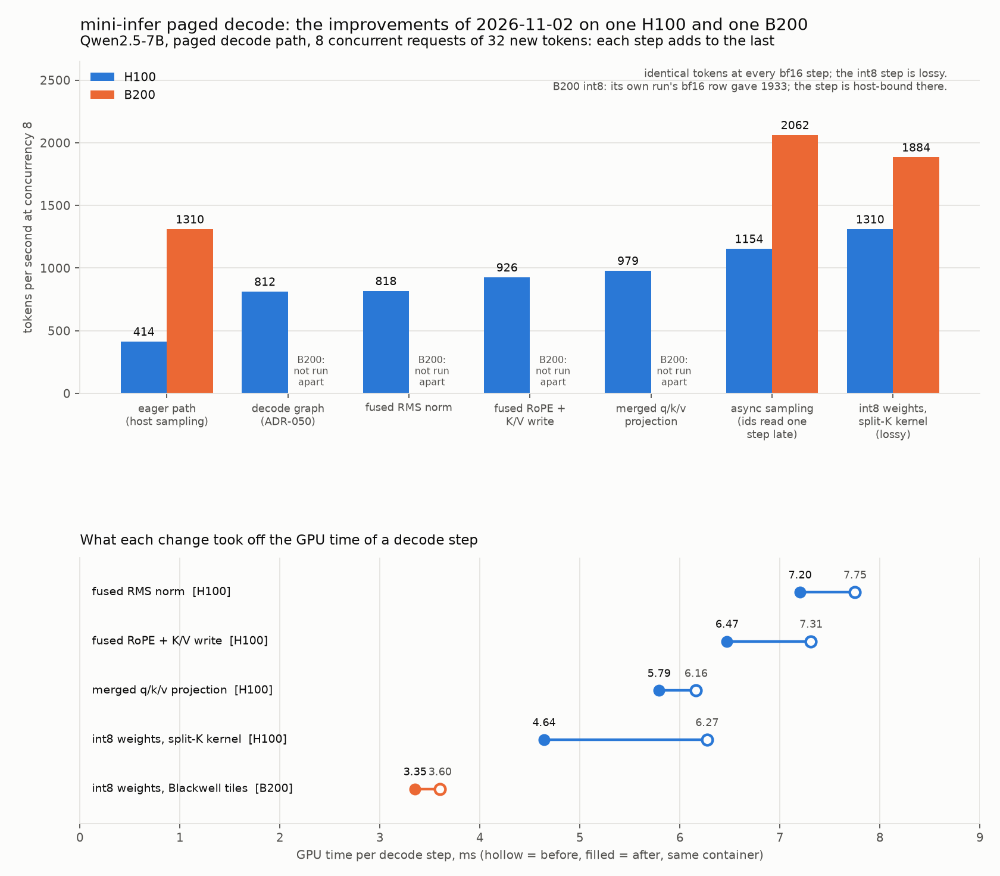

# The paged decode path on one H100 and one B200: one day of changes

Date: 2026-11-02
Hardware: one NVIDIA H100 80GB and one NVIDIA B200, CUDA 12.8 runtime,
torch 2.10.0+cu128, FlashInfer 0.6.10
Model: `Qwen/Qwen2.5-7B` in bf16, and the same weights as weight-only int8
Workload: the eight bench prompts, greedy decode, 32 new tokens, concurrency
1 and 8, through `ContinuousScheduler` on `PagedKVCache`
Engine: mini-infer from `1aed800` (the `--profile` flag) to `4a97186` (the
split-K int8 kernel), decisions in
[ADR-050](../decisions/ADR-050-paged-decode-cuda-graph.md) and
[ADR-051](../decisions/ADR-051-paged-decode-fewer-kernels.md)
Scripts: `scripts/bench/modal_bench_all.py --profile` for the first profile,
then one same-container A/B script per change (two techniques in one
container, same prompts, tokens compared)

## Question

The paged path ran the decode step eagerly and the host was its limit. This
report records what each change did to the step, on one H100 where the
changes were made, and on one B200 where the result was measured at the end.

## Result

The chain on the H100 at concurrency 8, tokens per second, with the "after"
row of each A/B:

| Step | H100 tok/s | What changed |
|---|---:|---|
| Eager path, host sampling | 414 | the baseline of ADR-050 |
| Decode graph | 812 | one graph replay per step, ADR-050 |
| Fused RMS norm | 818 | one kernel per norm, ADR-051 |
| FlashInfer plan without host waits | not measured apart | host syncs per step 6 to 3, ADR-051 |
| Fused RoPE and K/V write | 926 | one Triton kernel per layer, ADR-051 |
| Merged q, k and v projection | 979 | one GEMM per layer, ADR-051 |
| Async sampling | 1154 | the ids feed the next step on the device, the host reads them one step late (#65) |
| Int8 weights, split-K kernel | 1310 | lossy, the W8A16 decode kernel of #66 |

Every bf16 step decoded identical tokens to the step before it. The int8
step is lossy: the worst last-token logits cosine against bf16 over the eight
prompts was 0.9972, all eight kept their top token, and in the 32-token greedy
runs four of eight requests matched bf16 to the end.

The B200 ran three of the configurations in one container:

| Configuration | B200 tok/s at 8 | B200 tok/s at 1 | GPU ms per decode step at 8 | Wall ms per step at 8 |
|---|---:|---:|---:|---:|
| Eager path, host sampling | 1310 | 171 | 3.62 | 13.3 |
| Graph, async sampling, bf16 | 2062 | 256 | 3.54 | 3.5 |
| Graph, async sampling, int8 with the H100 tile | 2035 | 246 | 3.52 | 3.4 |
| Graph, async sampling, int8 with the Blackwell tiles (its own run, bf16 row 1933) | 1884 | 234 | 3.35 | 3.0 |

The wall times come from the profiled run, where the profiler slows the host.
On the B200 the eager step took 13.3 ms of wall time for 3.6 ms of GPU work,
so the host was the limit by a factor of nearly four. The graph with async
sampling brought the step to its GPU time. Int8 then cut the GPU time of the
step by 7 percent with the Blackwell tiles, but the throughput did not move
within the run-to-run variance of about 6 percent, because a 3.4 ms step is
host-bound again: the scheduler work plus the launch of a 685-node graph,
against 461 nodes for bf16.

## GPU time per decode step

Each pair comes from one A/B in one container, at the profiled level.

| Change | GPU | Before, ms | After, ms | Level |
|---|---|---:|---:|---:|
| Fused RMS norm | H100 | 7.75 | 7.20 | 1 |
| Fused RoPE and K/V write | H100 | 7.31 | 6.47 | 1 |
| Merged q, k and v projection | H100 | 6.16 | 5.79 | 1 |
| Async sampling (wall, not GPU) | H100 | 8.1 | 6.5 | 8 |
| Int8 weights, split-K kernel | H100 | 6.27 | 4.64 | 8 |
| Int8 weights, Blackwell tiles | B200 | 3.60 | 3.35 | 8 |

## The int8 kernel per call

GPU time per call with the calls captured in a CUDA graph, 20 calls per
graph. An eager loop of Triton launches measures the Python launch cost
instead, which is larger than the kernel at these shapes.

| Shape (N by K) | H100 cuBLAS bf16, us | H100 split-K int8, us | B200 cuBLAS bf16, us | B200 split-K int8, us |
|---|---:|---:|---:|---:|
| gate and up, 18944 by 3584 | 53.6 | 32.6 | 22.7 | 18.2 |
| down, 3584 by 18944 | 50.4 | 32.5 | 27.7 | 22.7 |
| q, k and v, 4608 by 3584 | 9.4 | 10.3 | 7.0 | 8.2 |
| o, 3584 by 3584 | 7.9 | 9.5 | 10.3 | 9.2 |

The two small shapes stay in the L2 cache inside a graph of 20 calls, so
their numbers flatter both sides. On the H100 the int8 kernel reads the MLP
weights at 2.1 to 2.25 TB/s. On the B200 cuBLAS reaches 6 TB/s on bf16 and
the Triton kernel about 4 TB/s of int8 bytes, so int8 wins by 1.2 to 1.25
times there against 1.6 to 1.7 on the H100.

## What is next

- The H100 step with int8 is 4.6 ms of GPU time and about 2.3 ms of host
  work plus the launch of 657 graph nodes, so the host is close to the limit
  again. The same holds on the B200 at 3.4 ms. The next lever on both is
  node count and scheduler work: fuse the reduce into the int8 kernel, and
  trim the Python of a step.
- The int8 kernel on Blackwell needs TMA loads to reach the bandwidth that
  cuBLAS reaches. That is a kernel of its own.
